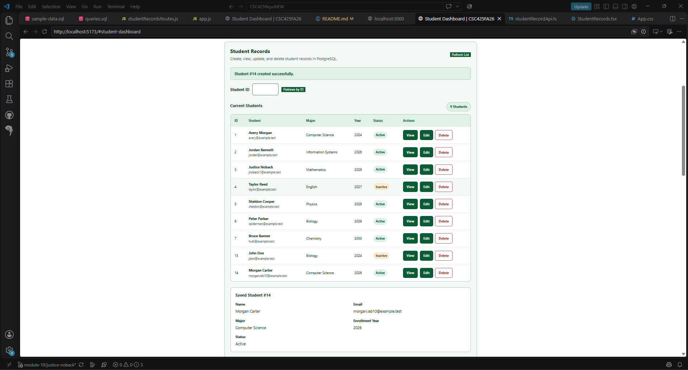
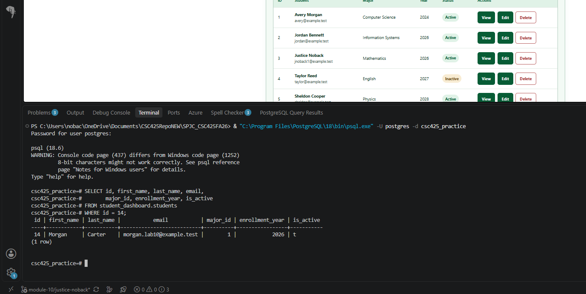
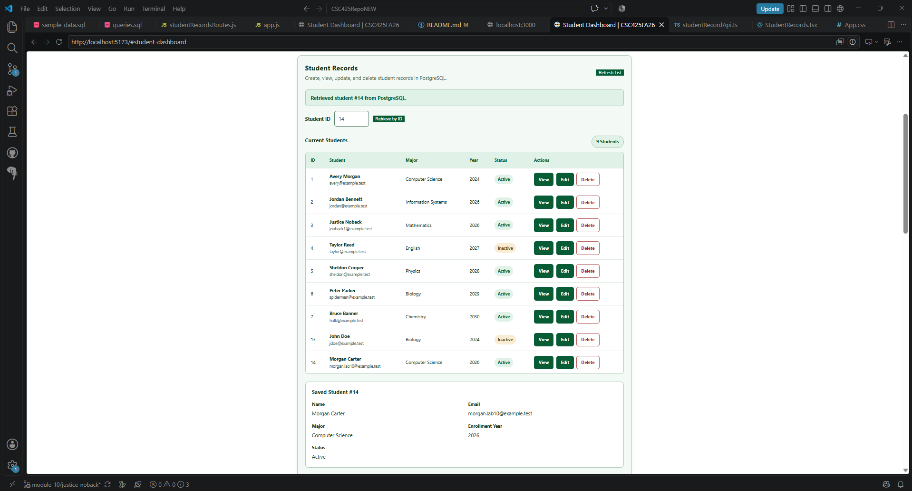
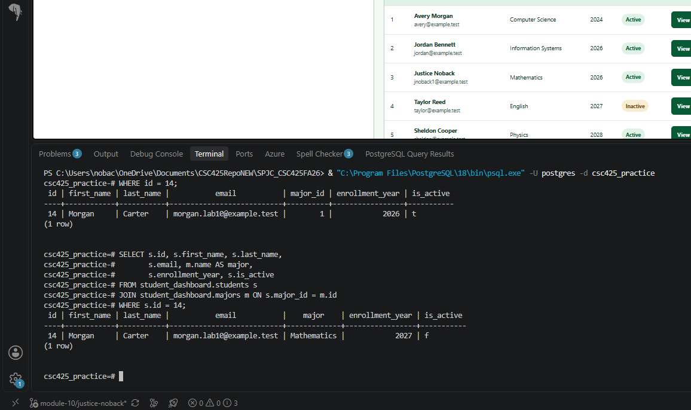
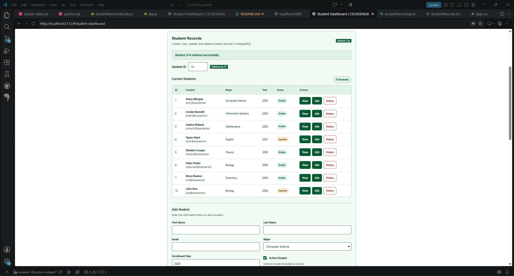
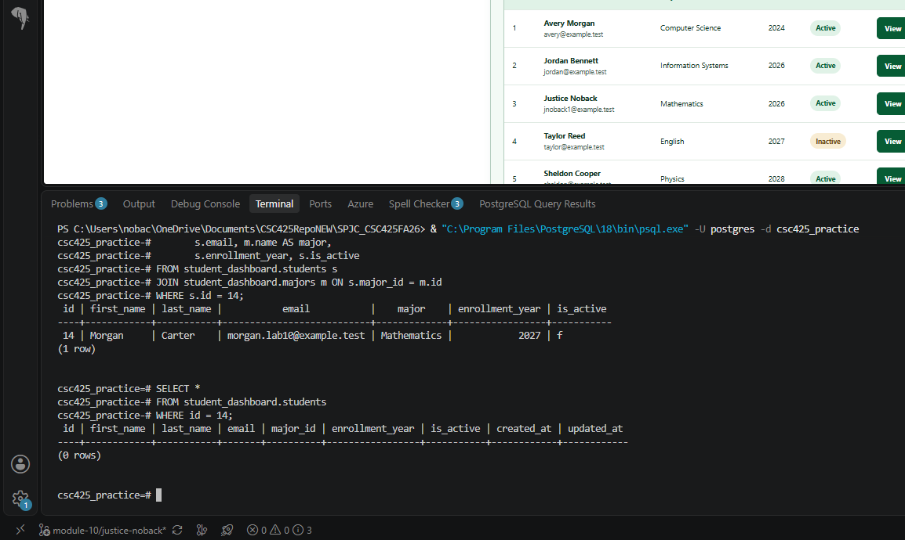

# CSC 425 Lab 10 - Student Records API

## Overview

For this lab, I added a PostgreSQL database to the project and created a CRUD API using Express.js. The React Student Dashboard uses Axios to communicate with the backend.

The API works with student records stored in the `student_dashboard.students` table. Through the dashboard, users can add, view, edit, and delete students. I also added an Active/Inactive status for each student, which can be changed and saved to the database.

## Base URL

`http://localhost:3000/api/student-records`

## API Endpoints

### GET /api/student-records

Gets all students from PostgreSQL, along with their majors and active statuses.

Example response:

```json
{
  "students": [
    {
      "id": 1,
      "first_name": "Avery",
      "last_name": "Morgan",
      "email": "avery@example.test",
      "major_id": 1,
      "major": "Computer Science",
      "enrollment_year": 2024,
      "is_active": true
    }
  ]
}
```

### GET /api/student-records/:id

Gets a specific student using their database ID. This is used for the Retrieve by ID and View features in the dashboard.

Example request:

`GET /api/student-records/1`

Example response:

```json
{
  "id": 1,
  "first_name": "Avery",
  "last_name": "Morgan",
  "email": "avery@example.test",
  "major_id": 1,
  "major": "Computer Science",
  "enrollment_year": 2024,
  "is_active": true
}
```

The response also includes the student's `created_at` and `updated_at` timestamps.

If the student cannot be found, the API returns HTTP 404.

### POST /api/student-records

Adds a new student to PostgreSQL using the information entered in the dashboard form.

Example request body:

```json
{
  "first_name": "Alex",
  "last_name": "Johnson",
  "email": "alex.frontend@example.test",
  "major_id": 1,
  "enrollment_year": 2026,
  "is_active": true
}
```

Returns HTTP 201 along with the new student record, including its assigned ID, status, and timestamps.

The `is_active` field controls whether the student is marked Active or Inactive. This is set using the Active Student checkbox in the form.

### PUT /api/student-records/:id

Updates an existing student using their ID. This allows changes to their name, email, major, enrollment year, and Active/Inactive status.

Example request:

`PUT /api/student-records/10`

Example request body:

```json
{
  "first_name": "Alex",
  "last_name": "Johnson",
  "email": "alex.frontend@example.test",
  "major_id": 3,
  "enrollment_year": 2027,
  "is_active": false
}
```

Returns HTTP 200 along with the updated student information, including the saved status and updated timestamp.

Checking the Active Student checkbox saves `true`, while unchecking it saves `false`.

### DELETE /api/student-records/:id

Deletes a student from PostgreSQL using their ID.

Example request:

`DELETE /api/student-records/10`

Example response:

```json
{
  "message": "Student deleted successfully",
  "student": {
    "id": 10,
    "first_name": "Alex",
    "last_name": "Johnson",
    "email": "alex.frontend@example.test",
    "major_id": 3,
    "enrollment_year": 2027,
    "is_active": true
  }
}
```

The response also includes the student's database timestamps.

Students who have existing enrollments cannot be deleted because of the foreign-key constraints in PostgreSQL.

## Error Responses

- **400:** Invalid student ID, missing information, invalid major ID, or invalid Active/Inactive status.
- **404:** The student could not be found.
- **409:** The email is already being used, or the student has enrollments that prevent deletion.
- **500:** Something went wrong with the server or database.

## Student Dashboard Features

I added a Student Records section to the existing Student Dashboard. This section allows users to manage student information directly from the application.

- **Current Students:** Shows student IDs, names, emails, majors, enrollment years, and Active/Inactive statuses.
- **Retrieve by ID:** Lets users search for a student using their ID.
- **View:** Shows the saved information for a selected student.
- **Refresh List:** Reloads the student list from PostgreSQL.
- **Add Student:** Adds a new student using the form.
- **Edit Student:** Loads a student's information into the form so it can be changed and saved.
- **Active Student:** Lets users change a student's status between Active and Inactive without deleting them.
- **Delete:** Removes a student from the database, as long as they do not have existing enrollments.

The dashboard uses Axios to send requests to the Express backend. Any changes made through the application are saved in PostgreSQL instead of only being stored in React.

## CRUD Verification

I tested the CRUD operations through the React Student Dashboard to make sure they were working correctly.

1. **CREATE:** Added a student named Alex Johnson with the email `alex.frontend@example.test`.
2. **READ:** Checked that the student appeared in both the dashboard and PostgreSQL.
3. **UPDATE:** Changed the student's major from Computer Science to Mathematics and the enrollment year from 2026 to 2027.
4. **DELETE:** Deleted the student using the Delete button in the dashboard.

PostgreSQL assigned this student the ID `10`, which I used throughout the testing.

After deleting the student, I ran the following SQL query:

```sql
SELECT *
FROM student_dashboard.students
WHERE id = 10;
```

The query returned zero rows, confirming that the student was successfully deleted from the database.

### Active/Inactive Status Verification

I also tested the Active/Inactive feature to make sure the status changes were actually being saved.

I marked Taylor Reed (student ID `4`) and John Doe (student ID `13`) as Inactive through the dashboard.

I then ran this query in PostgreSQL:

```sql
SELECT id, first_name, last_name, is_active
FROM student_dashboard.students
WHERE id IN (4, 13);
```

Both students returned `f` for `is_active`, showing that their statuses were saved correctly.

In PostgreSQL, `t` means `true` (Active), and `f` means `false` (Inactive).

## Database Tables

For this lab, I created four related tables in PostgreSQL:

- `student_dashboard.majors`
- `student_dashboard.students`
- `student_dashboard.courses`
- `student_dashboard.enrollments`

These tables use primary keys, foreign keys, and other constraints to keep the data organized and prevent invalid records.

The `students` table also includes an `is_active` Boolean column. This defaults to `TRUE` if a status is not provided.

## Existing Functionality

I kept the original mock Student Lookup and Transcript endpoints from the earlier labs.

The new PostgreSQL functionality uses its own `/api/student-records` routes, so it does not interfere with the existing features.

I also kept the Student Records section within the existing dashboard layout and added its styling to `App.css` so it matches the rest of the application.

## Database Setup

To run the Student Records feature, PostgreSQL needs to be installed and running.

First, create a PostgreSQL database. For this project, I used `csc425_practice`, although any database name will work as long as it matches the name in the `.env` file.

Next, copy `server/.env.example` to `server/.env` and enter the correct database information.

Example configuration:

```dotenv
PORT=3000
DB_HOST=localhost
DB_PORT=5432
DB_NAME=csc425_practice
DB_USER=postgres
DB_PASSWORD=your_password_here
```

The `.env` file contains private connection information and should not be committed to GitHub.

From the repository root, run these commands to create the tables and insert the sample data:

```powershell
psql -U postgres -d csc425_practice -f server/database/schema.sql
psql -U postgres -d csc425_practice -f server/database/sample-data.sql
```

The `schema.sql` file creates the four related tables, while `sample-data.sql` adds fictional majors, students, courses, and enrollments.

The `queries.sql` file contains additional SQL examples that can be run separately.

After setting up the database, install the project dependencies if needed:

```powershell
npm run install:all
```

Start the frontend and backend from the repository root:

```powershell
npm run dev
```

The application can be accessed at:

- Frontend: `http://localhost:5173`
- Backend: `http://localhost:3000`
- Student Records API: `http://localhost:3000/api/student-records`

Open the Student Dashboard to access the Student Records section.

## Additional CRUD Testing and Screenshots

I also performed a complete CRUD test through the Student Dashboard to make sure the application and PostgreSQL were working together correctly.

For this test, I used the same student record throughout the CREATE, READ, UPDATE, and DELETE operations.

### 1. CREATE - Add a New Student

I created a new fictional student using the Add Student form in the dashboard.

After creating the student, PostgreSQL assigned a student ID, which I used for the rest of the test.

**Dashboard screenshot after creating the student:**



I then checked PostgreSQL using the following query:

```sql
SELECT *
FROM student_dashboard.students
WHERE id = 14;
```

**PostgreSQL screenshot confirming the student was saved:**



### 2. READ - Retrieve the Student

Next, I used the Retrieve by ID feature in the dashboard to search for the same student.

The application retrieved the record from PostgreSQL and displayed the saved information.

**Dashboard screenshot showing the retrieved student:**



### 3. UPDATE - Edit the Student

I selected Edit for the same student and changed their information, including their Active/Inactive status.

After saving the changes, I retrieved the student again through the dashboard to make sure the updated information was displayed.

**Dashboard screenshot showing the updated student:**


I also verified the changes directly in PostgreSQL:

```sql
SELECT id, first_name, last_name, email,
       major_id, enrollment_year, is_active
FROM student_dashboard.students
WHERE id = 14;
```

**PostgreSQL screenshot confirming the updated information:**



### 4. DELETE - Remove the Student

Finally, I deleted the same student, Morgan Carter (student ID 14), using the Delete button in the dashboard.

After deleting the student, the dashboard displayed a success message confirming that student ID 14 was deleted.

**Dashboard screenshot showing the successful deletion message:**



I also ran the following SQL query to confirm that the student was removed from PostgreSQL:

```sql
SELECT *
FROM student_dashboard.students
WHERE id = 14;
```

The query returned zero rows, confirming that student ID 14 no longer existed in the database.

**PostgreSQL screenshot confirming that the query returned zero rows:**



### Test Results

After completing the test, I confirmed that the Student Dashboard was able to create, retrieve, update, and delete the same student record through the Express API.

The PostgreSQL queries were used to verify that the information was actually being saved, updated, and deleted from the database.

The same student ID (14) was used throughout the demonstration to make sure each operation was performed on the correct record.