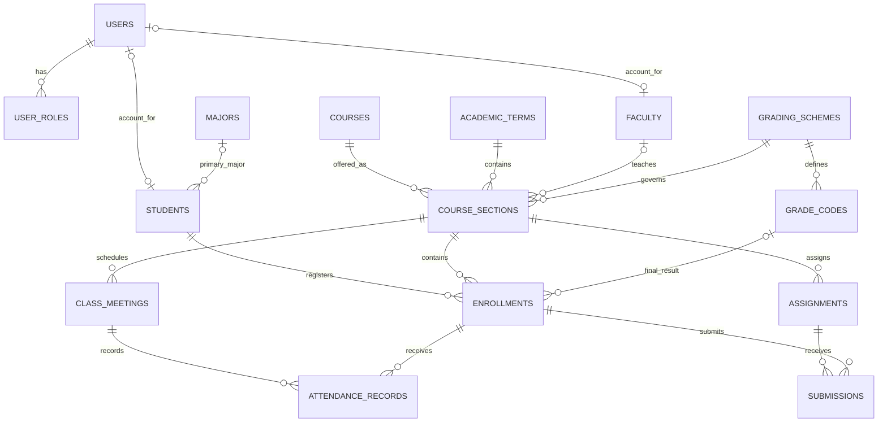

# Proposed application database schema

Status: **design for review, not an applied migration**. Reviewed against the current repository on October 27, 2026. No application code, existing tables, or data were changed for this review.

Historical note — October 29, 2026: the application now reads student lookup and transcripts from PostgreSQL, the GPA calculator is a separate component, and the student Alerts and Upcoming Courses modules have been removed. The old transcript fixture was deleted. The snapshot and migration recommendations below describe the earlier design review, not the current implementation.

The follow-up [complete table/column inventory and CREATE TABLE SQL](proposal/TABLES_AND_SQL.md) provides executable fresh-database definitions for all 18 main tables and the 3 optional modules. These definitions were validated in a disposable database; they have not been applied to the current application database.

The current majors/students schema is a suitable first CRUD lesson. The complete Student, Faculty, and Admin dashboards need a shared academic model: students enroll in particular course sections offered during academic terms. Those enrollments connect rosters, grades, transcripts, attendance, and reports.

## Application snapshot from October 27, 2026

| Module | Source at review time | Schema implication |
| --- | --- | --- |
| Student records | PostgreSQL through `studentRecordsData.js` | Preserve existing student/major IDs and the working CRUD flow. |
| Student lookup | `mockStudents` in `server/src/app.js` | Eventually query the same students table; names are not unique identifiers. |
| Transcripts | Former JSON transcript fixture (since removed) | Replace duplicated course/semester arrays with courses, terms, sections, enrollments, and grade rules. |
| GPA calculator | React state in `Dashboardstudent.tsx` | Keep as a clearly labeled practice calculator; academic GPA must use saved credit-weighted grades. |
| Upcoming courses | Student placeholder | Query the student's active enrollments and future class meetings. |
| Faculty courses and class rosters | Faculty placeholders | Link faculty to sections, and students to those sections through enrollments. |
| Faculty grading | Faculty placeholder | Store assignments, submissions, feedback, and final course grades. |
| Attendance | Faculty roster text; student card currently commented out | Record actual class meetings and each enrolled student's attendance. |
| Teaching schedule | Faculty placeholder | Class meetings; optional office hours and appointments later. |
| User/course management | Admin placeholders | Accounts/roles plus catalog, terms, sections, faculty assignments, and capacity. |
| Alerts across all dashboards | Placeholders | Shared notifications with one recipient/read-state row per account. |
| Reports | Admin placeholder | Views/queries over enrollment, attendance, and grades. |
| Weather / system status | External weather API / health route | No academic database table needed for their current behavior. |

### Findings that affect the design

1. **Student identity is currently split.** New records use integer IDs; mock records use strings such as `1001`. Add a separate unique `student_number` and explicitly map old fixture IDs. Do not assume database ID 1 means mock student 1001.
2. **The samples disagree.** Taylor Reed has Mathematics in `002_sample_inserts.sql`, but Business Administration in the mock lookup and transcript. Reconcile this intentionally; matching by name alone is unsafe.
3. **A course is not a section.** `CSC 425` is a catalog course; `CSC 425 / Fall 2026 / Section 01` is an offering with an instructor, capacity, schedule, and roster.
4. **GPA has two current meanings.** The local calculator uses equal weight per entered grade, while the transcript fixture uses credit weighting. Official academic views should derive results from enrollment grades and one documented grading policy.
5. **A role tab is not authorization.** `App.tsx` selects views from URL hashes; it does not authenticate users. Adding role tables must be accompanied by server-side permission checks when accounts are implemented.
6. **Deletion rules must evolve.** The present CRUD demo deletes a student row. Once enrollments exist, preserve academic history and reject physical deletion of referenced students. Deactivate accounts/profiles instead.

## Scope and conventions

- One institution, one primary major per student, and one primary instructor per section in the initial design. These are explicit simplifications, not claims about institutional policy.
- Retain PostgreSQL and the existing `student_dashboard` namespace for incremental work. A later rename is optional and not needed for correctness.
- Ordinary entity IDs use `integer GENERATED ALWAYS AS IDENTITY`, matching the existing API's numeric IDs. Foreign-key columns use the same type. An audit log can use `bigint` identity; if exposed to JavaScript, serialize that ID as a string.
- `PK` means primary key; `FK` means foreign key; `UQ` means unique. All fields below are required unless marked **nullable**. Entity tables have `created_at` and `updated_at` as `timestamptz`, unless noted otherwise. Link tables use the timestamps explicitly listed.
- Use database-maintained `updated_at` values for mutable tables, including SQL edits made outside Express. `DEFAULT now()` alone does not update a row's timestamp on later edits.
- Trim required names and reject blank values. Keep codes/student numbers as text, preserving leading zeros. Normalize emails before storage and enforce uniqueness on their normalized value.
- Use `date` for term boundaries and `timestamptz` for actual events/deadlines. Configure an institutional IANA time zone for display and schedule generation; a timestamp does not retain the original named time zone. [PostgreSQL date/time types](https://www.postgresql.org/docs/current/datatype-datetime.html)

## Main relationships

This diagram shows the academic core. Notifications, auditing, and assignment workflow are described in the dictionary below.



## Proposed data dictionary

### Accounts and academic profiles

| Table | Columns and types | Keys and important rules |
| --- | --- | --- |
| `users` | `id integer`, `login_email varchar(254)`, `auth_provider varchar(50)`, `auth_subject text`, `is_active boolean`, `last_login_at timestamptz` nullable | PK `id`; UQ normalized `login_email`; UQ `(auth_provider, auth_subject)`. Proposal assumes an authentication provider; its subject identifies the account. Provider choice is pending. No plain-text passwords or session tokens here. |
| `user_roles` | `user_id integer`, `role_code varchar(20)`, `assigned_at timestamptz` | Composite PK `(user_id, role_code)`; FK user; CHECK role in `student`, `faculty`, `admin`. Supports a faculty member who is also an administrator. |
| `students` | Existing `id`, `first_name varchar(60)`, `last_name varchar(60)`, `email varchar(254)`, `is_active boolean`; add `student_number varchar(20)`, `user_id integer` nullable, `major_id integer` nullable, `admission_term_id integer` nullable | PK `id`; UQ student number; UQ student contact email; UQ non-null user ID; FKs user, major, academic term. A profile can exist before a login account. Null major means undeclared. The existing `enrollment_year` is retained during migration until admission-term mapping is complete, then retired or exposed as a derived compatibility field. |
| `faculty` | `id integer`, `employee_number varchar(20)`, `user_id integer` nullable, `first_name varchar(60)`, `last_name varchar(60)`, `email varchar(254)`, `is_active boolean` | PK `id`; UQ employee number, normalized faculty email, and non-null user ID; FK user. A faculty profile can exist before account provisioning. |
| `majors` | Existing `id integer`, `code varchar(10)`, `name varchar(100)`; add `is_active boolean` | Preserve PK and existing unique code/name. Deactivate a major rather than deleting a referenced major. |

`students.email` and `faculty.email` are academic contact addresses; `users.login_email` is the account login address. They can differ. If the product requires them to always match, remove the duplicated profile email and explicitly adapt the current API instead of maintaining two authoritative copies.

### Catalog, academic terms, and enrollment

| Table | Columns and types | Keys and important rules |
| --- | --- | --- |
| `courses` | `id integer`, `course_code varchar(20)`, `title varchar(160)`, `description text` nullable, `default_credit_hours numeric(4,2)`, `is_active boolean` | PK id; UQ course code; CHECK credits > 0 and <= 12. Code example: `CSC 425`. The 12-credit ceiling is a proposed application rule. |
| `academic_terms` | `id integer`, `code varchar(20)`, `name varchar(80)`, `starts_on date`, `ends_on date`, `registration_opens_at timestamptz`, `registration_closes_at timestamptz` | PK id; UQ code; CHECK start <= end and registration open <= close. Overlapping terms are allowed for summer sessions and short courses. |
| `grading_schemes` | `id integer`, `code varchar(40)`, `description text`, `is_active boolean` | PK id; UQ versioned code, e.g. `LETTER_4_0_V1`. Used schemes are immutable; changed policy creates a new version. |
| `grade_codes` | `grading_scheme_id integer`, `code varchar(3)`, `grade_points numeric(3,2)` nullable, `counts_for_gpa boolean`, `counts_as_attempted boolean`, `earns_credit boolean` | Composite PK `(grading_scheme_id, code)`; FK scheme. GPA-counted grades require points between 0 and 4 and must count as attempted. Non-GPA grades have null points. Used definitions are immutable. |
| `course_sections` | `id integer`, `course_id integer`, `term_id integer`, `section_number varchar(10)`, `instructor_id integer` nullable, `grading_scheme_id integer`, `course_code_snapshot varchar(20)`, `title_snapshot varchar(160)`, `credit_hours numeric(4,2)`, `capacity integer`, `delivery_mode varchar(20)`, `status varchar(20)` | PK id; FKs course, term, faculty, scheme; UQ `(course_id, term_id, section_number)`; UQ `(id, grading_scheme_id)` for a composite FK. Capacity > 0; credits > 0 and <= 12. Modes: `in_person`, `online`, `hybrid`. Status: `draft`, `open`, `closed`, `cancelled`, `completed`. Instructor may be unassigned while planning. |
| `enrollments` | `id integer`, `student_id integer`, `section_id integer`, `grading_scheme_id integer`, `status varchar(20)`, `enrolled_at timestamptz`, `withdrawn_at timestamptz` nullable, `final_grade_code varchar(3)` nullable, `grade_posted_at timestamptz` nullable, `grade_posted_by integer` nullable | PK id; FK student; composite FK `(section_id, grading_scheme_id)` to section; composite FK `(grading_scheme_id, final_grade_code)` to grade code; FK grade poster to users. UQ `(student_id, section_id)` and UQ `(id, section_id)`. Status: `enrolled`, `dropped`, `withdrawn`, `incomplete`, `completed`. A completed enrollment requires a posted grade, posting timestamp, and poster. |

The section's course code/title/credits are snapshots initialized from the catalog. Freeze them and the grading scheme once enrollment begins. Editing the current catalog must not silently rewrite past transcripts. If variable credit per student becomes necessary, add an enrollment-level credit snapshot explicitly.

The unique student/section constraint prevents duplicate registration in the same offering but permits retaking the course in another section or term. A dropped enrollment can be reactivated under policy, with the change audited, rather than inserting a duplicate row. One person taking multiple sections of the same course in one term is a policy decision not prohibited by this initial key.

### Attendance, assignments, and grading work

| Table | Columns and types | Keys and important rules |
| --- | --- | --- |
| `class_meetings` | `id integer`, `section_id integer`, `starts_at timestamptz`, `ends_at timestamptz`, `location varchar(160)` nullable, `meeting_url text` nullable, `status varchar(20)` | PK id; FK section; UQ `(section_id, starts_at)` and `(id, section_id)`. End > start. Status: `scheduled`, `held`, `cancelled`. Each row is an actual dated meeting, not a string such as “MWF 9 AM.” |
| `attendance_records` | `meeting_id integer`, `enrollment_id integer`, `section_id integer`, `status varchar(20)`, `recorded_by integer`, `recorded_at timestamptz`, `note text` nullable | Composite PK `(meeting_id, enrollment_id)`; matching-section composite FKs described below; FK recorder to users. Status: `present`, `absent`, `late`, `excused`. Missing row means not recorded, not absent. |
| `assignments` | `id integer`, `section_id integer`, `title varchar(160)`, `instructions text` nullable, `due_at timestamptz`, `max_points numeric(8,2)`, `is_published boolean` | PK id; FK section; UQ `(id, section_id)`. Max points > 0. Final course grades are posted separately; this initial schema does not assume a weighted assignment-category formula. |
| `submissions` | `id integer`, `assignment_id integer`, `enrollment_id integer`, `section_id integer`, `submitted_at timestamptz` nullable, `submission_text text` nullable, `attachment_key text` nullable, `points_awarded numeric(8,2)` nullable, `feedback text` nullable, `graded_by integer` nullable, `graded_at timestamptz` nullable | PK id; UQ `(assignment_id, enrollment_id)`; matching-section composite FKs; FK grader to users. A submitted row needs text or an attachment reference. A graded row requires points >= 0, grader, and timestamp together; ungraded rows have all three null. |

One submission row represents the current work for an assignment/enrollment pair. A null submission time permits recording a missing assignment grade of zero without fabricating a submission. Initial scope supports one current submission; add a submission-attempt table before promising version history or multiple attempts. Attachments live in file/object storage; the database stores a stable storage key, not an expiring signed URL.

**Prevent cross-section records with actual database constraints.** Both parent tables expose a unique `(id, section_id)` key:

```text
attendance_records(meeting_id, section_id)
    → class_meetings(id, section_id)
attendance_records(enrollment_id, section_id)
    → enrollments(id, section_id)

submissions(assignment_id, section_id)
    → assignments(id, section_id)
submissions(enrollment_id, section_id)
    → enrollments(id, section_id)
```

The repeated `section_id` deliberately lets composite foreign keys guarantee that both sides refer to the same class. Two unrelated single-column foreign keys would not guarantee this. [PostgreSQL constraint behavior](https://www.postgresql.org/docs/current/ddl-constraints.html)

### Shared alerts and audit history

| Table | Columns and types | Keys and important rules |
| --- | --- | --- |
| `notifications` | `id integer`, `created_by integer` nullable for system events, `section_id integer` nullable, `title varchar(160)`, `body text`, `severity varchar(20)`, `published_at timestamptz`, `expires_at timestamptz` nullable | PK id; FKs author to users and optional section. Severity: `info`, `warning`, `urgent`; expiry > publication when provided. |
| `notification_recipients` | `notification_id integer`, `user_id integer`, `delivered_at timestamptz`, `read_at timestamptz` nullable, `dismissed_at timestamptz` nullable | Composite PK `(notification_id, user_id)`; FKs notification and user. Each recipient has independent read/dismissed state; timestamps cannot precede delivery. |
| `audit_events` | `id bigint`, `actor_user_id integer` nullable for system events, `entity_type varchar(40)`, `entity_id integer`, `action varchar(30)`, `occurred_at timestamptz`, `change_summary jsonb` | PK identity id; FK actor. Append-only events for account, enrollment, final-grade, and administrative changes. No `updated_at`. `entity_id` is an audited identifier, deliberately not a polymorphic FK; validate the entity type and ID in the writing service. Omit credentials and attachment content. |

Resolve notification recipients at publication time and persist them. A later role change should not silently change who received a past announcement. Role assignment and audit-write permissions must be controlled by the server/database account, not by hiding frontend buttons.

## Calculated results and policy boundaries

Do not create separately editable GPA, roster, transcript, or report-summary tables. They would duplicate the same enrollment facts.

| Read model | Derivation |
| --- | --- |
| Class roster | Enrollments + students for one section, filtered by enrollment status. |
| Upcoming courses | Active enrollments + sections + terms + future noncancelled meetings. |
| Transcript | Student identity + enrollment results + term + section snapshots + versioned grade codes. |
| Term/cumulative GPA | Sum of eligible `credit_hours × grade_points`, divided by eligible credit hours. Return null when denominator is zero; round only the final displayed GPA. |
| Attempted/earned credits | Sum section credits using the posted grade's attempted/earned flags and the approved enrollment/repeat policy. |
| Attendance rate | Recorded attendance for held meetings using the approved treatment of late/excused entries. Display unrecorded meetings separately. |
| Faculty work queue | Published assignments + enrollments + submissions lacking a grade, with missing work shown explicitly. |
| Admin reports | Aggregate the same enrollment, grade, and attendance sources by section and term. |

Possible grade rules: A earns credit and has 4.00 points; F earns none and has 0.00 points but counts in GPA; pass/fail P can earn credit without entering the GPA denominator. Withdrawal/incomplete and repeated-course rules require an instructor-approved policy. These examples are proposals, not verified institutional rules.

Use ordinary views or query modules first. Materialized reports are unnecessary at current classroom scale. Versioned rules and frozen section snapshots protect history; full official transcript issuance and credential verification are beyond this application scope.

## Enforcement, indexes, and deletion

**Database constraints:** primary/foreign keys, unique registration, valid statuses, required fields, nonnegative points, date ordering, and matching section relationships belong in the database. Pair optional-field CHECK conditions with explicit null rules; SQL CHECK expressions evaluating to null do not reject a row. [PostgreSQL constraints](https://www.postgresql.org/docs/current/ddl-constraints.html)

**Transactional service rules:** capacity checks must lock the section while checking seats and inserting/reactivating an enrollment. Instructor/room conflicts, meetings within term dates, enrollment eligibility, final-grade transitions, frozen catalog snapshots, and `points_awarded <= assignments.max_points` require cross-row logic or carefully designed triggers. They cannot be implemented as ordinary cross-table CHECK constraints. Reducing assignment max points must also validate already graded submissions.

**Authorization:** students access their own records; faculty access sections assigned to them; administrators manage approved academic/account data. Verify this on the server for every operation. Also check that a recorded grader/instructor/recipient is the appropriate authorized account; an FK alone only proves that the account exists.

**Indexes:** retain `students(major_id)` and unique keys. Add indexes for `course_sections(term_id)`, `course_sections(instructor_id, term_id)`, `enrollments(section_id, status)`, and `enrollments(student_id)` if not already covered by a leading unique-key column. Index referencing composite foreign keys where no existing index has the same useful prefix, and indexes supporting attendance/submission lookups by enrollment. Add `notification_recipients(user_id, delivered_at)` for an inbox; an optional partial index where `read_at IS NULL` can serve unread queries. Avoid redundant indexes already provided by PK/UQ constraints. [Partial indexes](https://www.postgresql.org/docs/current/indexes-partial.html)

**Deletion:** use RESTRICT for academic relationships. A referenced major, student, faculty member, course, section, term, enrollment, or grade definition must not disappear through a cascade. Deactivate profiles/catalog entries, cancel planned offerings, and record withdrawals instead. Account retirement must preserve the identity needed for historical authorship. Cascading a notification's recipient rows can be reasonable only when intentionally removing that notification under an agreed retention rule.

## Later extensions tied to existing placeholders

These are optional modules, not required for the first academic-schema implementation:

| Table | Proposed fields | Supports |
| --- | --- | --- |
| `course_materials` | identity id; section FK; title; nullable URL/storage key with at least one required; creator FK; published timestamp | Faculty course materials. |
| `office_hours` | identity id; faculty FK; starts/ends timestamps with end > start; location or meeting URL | Dated faculty availability. Generate recurring occurrences using the institutional time zone. |
| `appointments` | identity id; office-hours FK; student FK; start/end timestamps; status | Student appointments. Booking must validate the faculty slot, time boundaries, and overlapping active reservations transactionally. |

Additional majors/minors require `student_programs` with effective dates. Team teaching requires `section_instructors`. Add departments/rooms only when their own management and scheduling rules are needed. Fees, payments, admissions workflows, and institution-wide tenancy are outside the reviewed modules.

## Migration impact and recommended implementation order

1. **Keep the current two-table lab working.** Add new tables through new versioned migrations. Do not overwrite `001_student_records.sql` and assume `CREATE TABLE IF NOT EXISTS` will update an installed schema.
2. **Reconcile identity before importing transcripts.** Add/backfill unique student numbers, map fixture identities explicitly, resolve the Taylor Reed major mismatch, and decide which fictional records to import. Preserve existing student primary keys.
3. **Add catalog, terms, faculty, grading schemes, sections, and enrollments.** Seed a small coherent semester. One student enrolled in two sections is sufficient to prove the relationships before expanding the data set.
4. **Account for nullable majors.** The proposed undeclared-major support requires LEFT JOINs in `studentRecordsData.js`, nullable `majorId`/`majorName` API types, validation changes, and a form option. Keep the existing required-major contract until that change is implemented together.
5. **Unify lookup and transcript reads.** Read from PostgreSQL and preserve explicit JSON response contracts. Relax the mock-only four-digit student-ID restriction only when the new student-number format is agreed. Use admission-term data to replace the legacy enrollment-year field without inventing missing historical terms.
6. **Add accounts and server-side authorization before access by real users.** Provider subjects link to academic profiles; role changes are authorized operations. Authentication-provider selection is a separate implementation decision.
7. **Add attendance, assignments/submissions, notifications, and audit events incrementally.** Test mismatched-section rejection, duplicate registration, history protection, and role permissions alongside normal CRUD.
8. **Update deletion error handling.** The existing route maps every FK error to `INVALID_MAJOR`. After students have enrollments, a blocked student deletion needs a specific `409 STUDENT_HAS_ENROLLMENTS` response and a deactivate workflow. Do not reuse the major error for unrelated constraints.

Suggested first expansion: majors, students, faculty, courses, academic terms, grading schemes/codes, sections, and enrollments. The remaining modules can be added without changing that academic core.

## Decisions for review

- Are undeclared students allowed, and is one primary major sufficient initially?
- Should student numbers retain the existing four-digit demonstration format or use a longer institution-assigned format?
- Does one instructor per section fit the lesson, or should team teaching be included now?
- What grading scale, repeat-course policy, withdrawal treatment, and attendance rules should the reports use?
- Is grading limited to final course grades first, or should assignment submissions/feedback be included in the next phase?
- Should authentication use an external provider, and may one account hold multiple roles as proposed?

This is a reviewed logical schema and migration plan, not executable DDL. Its cross-row rules and authorization remain proposed work. No SQL was applied and no migrations, routes, or forms were changed for this review.
